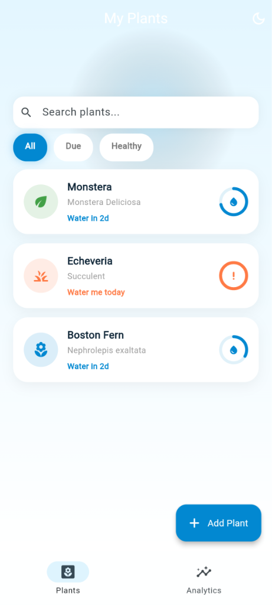
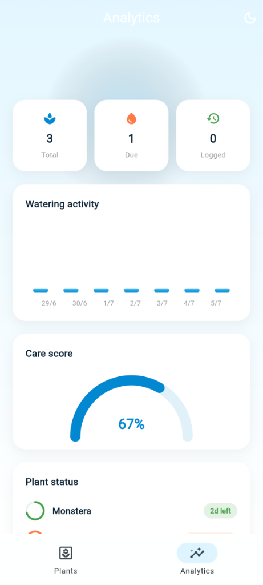

# 🌿 Plant Water Reminder App

A beautifully crafted, modern, and feature-rich Flutter application designed to help plant lovers track, schedule, and log their plants' watering needs. With clean animations, a detailed analytics dashboard, custom-painted progress rings, and a dynamic dark mode, keeping your plants healthy has never been easier.

---

## 📸 Screenshots

Here is a preview of the app interface:

| 📱 My Plants (Dashboard) | 📊 Analytics Page |
| :---: | :---: |
|  |  |

---

## ✨ Features

- **🌿 Complete Plant Registry**: Add and track multiple plants with custom names, species details, sunlight requirements, and custom icons/colors.
- **📅 Adaptive Schedules**: Set customizable watering intervals (1 to 30 days) and view precise countdowns for when each plant is due.
- **🔍 Search & Filter**: Dynamically filter plants by their state (`All`, `Due`, `Healthy`) and easily locate them using the responsive search bar.
- **💧 Smart Watering Logger**: Log watering events instantly with a single tap, accompanied by satisfying micro-interactions and smooth burst animations.
- **📊 Interactive Analytics**:
  - **Care Score Gauge**: View an automatically computed percentage score representing the current wellness status of all your plants.
  - **Watering Activity Chart**: Analyze your watering patterns over the last 7 days through a custom-rendered bar chart.
  - **Quick Stats**: Review total plants, due alerts, and total logged actions at a glance.
- **🌓 Dynamic Dark Mode**: Sleek light and dark themes using a custom state controller for comfortable use day or night.
- **🗑️ Swipe to Dismiss**: Keep your garden registry clean with a simple, haptic-supported swipe-to-delete action.

---

## 🛠️ Technology Stack

- **Framework**: [Flutter](https://flutter.dev) (built with Dart)
- **UI Design**: Modern Material 3 guidelines
- **State Management**: Lightweight, custom `ChangeNotifier` and `ValueNotifier` architecture
- **Custom Visuals**: `CustomPainter` for the progress rings, care score gauge, and analytics bar charts
- **Assets & Styling**: Clean HSL/RGB tailored color palettes, custom gradients, and responsive layouts

---

## 🚀 Getting Started

Follow these steps to get a local copy of the project up and running:

### Prerequisites

Make sure you have the Flutter SDK installed on your machine. For installation guides, visit the official [Flutter installation docs](https://docs.flutter.dev/get-started/install).

### Installation

1. **Clone the Repository**:
   ```bash
   git clone https://github.com/YouBTech01/Plants-Water-Reminder-app.git
   ```

2. **Navigate to the Project Directory**:
   ```bash
   cd Plants-Water-Reminder-app
   ```

3. **Get Dependencies**:
   ```bash
   flutter pub get
   ```

4. **Run the Application**:
   - Ensure you have an emulator running or a physical device connected.
   - Run the command:
     ```bash
     flutter run
     ```

---

## 🎨 Design System

The application utilizes a curated, harmonious design language:

* **Sky Palette**:
  - Light Sky: `#E3F6FF` (Light background)
  - Mid Sky: `#4FC3F7` (Accent/Charts)
  - Deep Sky: `#0288D1` (Primary actions, titles)
* **Accent Colors**:
  - Healthy Green: `#43A047`
  - Warning Orange: `#FFFF7A45`
  - Ink Contrast: `#0D2436` (For high-readability text)

---

## 📄 License

This project is licensed under the MIT License. Feel free to use and adapt it for your own personal or educational projects!
